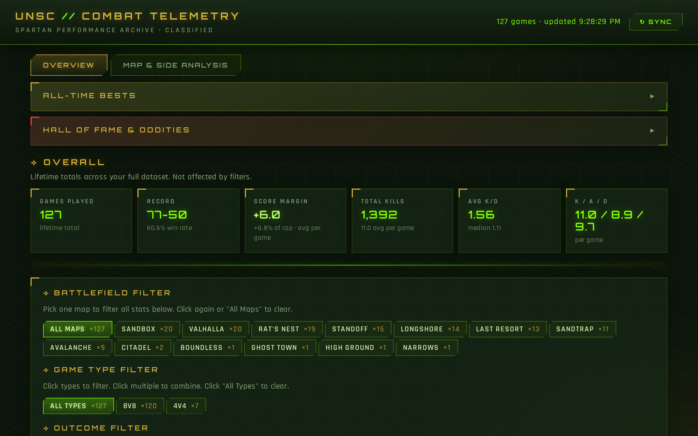
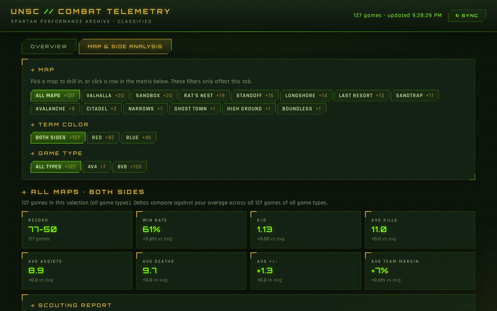
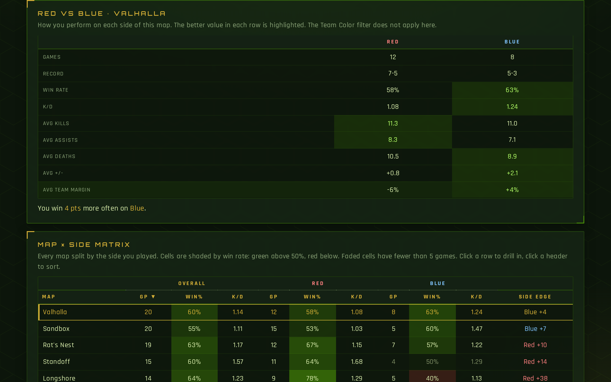

# Halo Dashboard · Combat Telemetry

A live analytics dashboard for my Halo 3 matches. I log every game in a Google Sheet, and the dashboard turns it into win rates, K/D trends, map-by-map and team-side breakdowns, and auto-generated scouting notes. Nothing is stored or exported: update the sheet, refresh the page, and the numbers change.

**▶ Live demo: [maximhoeft94.github.io/halo-dashboard](https://maximhoeft94.github.io/halo-dashboard/)**



## What it does

**Overview tab**
- Lifetime record, K/D, kills/assists/deaths and score margin
- All-Time Bests and a "Hall of Fame & Oddities" panel (closest games, biggest blowouts, streaks, best K/D in a loss…)
- Map, game-type and win/loss filters that drive every chart below them
- Recent form (last 25 games vs. baseline) with auto-detected tendencies and recommendations
- K/D over time with a 5-game rolling average, stat distributions, game-type comparison and a full match log

**Map & Side Analysis tab**
- Drill into any map and/or team color (Red vs Blue) with its own independent filters
- Summary cards showing how the selection compares to your overall average
- Scouting report: best and toughest maps, biggest side splits, recent form on a map, best and worst game
- Red vs Blue head-to-head table with the stronger side highlighted
- Sortable map × side matrix, heat-shaded by win rate, with small samples flagged
- Win rate by map and side chart, K/D trend and game list for the current selection




## How it works

```
Google Sheet ──(CSV export)──▶ browser / Flask ──▶ single-page dashboard (Chart.js)
```

- **Data source:** a Google Sheet shared as view-only. Each row is one game: map, game type, team, score, kills, assists, deaths.
- **Web version (`index.html`):** a static page hosted on GitHub Pages. It fetches the sheet's CSV export straight from the browser, parses it, and renders everything client-side, so there's no backend to run.
- **Local version (`halo_dashboard.py`):** a Flask app that pulls the same sheet with `pandas` and serves the dashboard at `localhost:5050`. I launch it from a one-click macOS app.
- **One source of truth:** the page's HTML, CSS and JavaScript live in `halo_dashboard.py`. `build_static.py` generates `index.html` from it, so both versions always match.

**Stack:** Python · pandas · Flask · JavaScript · Chart.js · HTML/CSS · Google Sheets · GitHub Pages

## Run it locally

```bash
pip install -r requirements.txt
python3 halo_dashboard.py
# open http://localhost:5050
```

To use your own sheet, change `SHEET_ID` and `TAB_NAME` at the top of `halo_dashboard.py`. The sheet needs these columns: `Game, Game Type, Map, Team, Good Guys, Bad Guys, Result, Kills, Assists, Deaths, Diff, Ratio`, and it must be shared as "Anyone with the link can view".

## Updating the website

- **New games:** just add rows to the Google Sheet. The live site reads it on every page load (or hit **Sync**).
- **Design or code changes:** edit `halo_dashboard.py`, then run `python3 build_static.py` and push.

---
Built by Maxim Hoeft.
